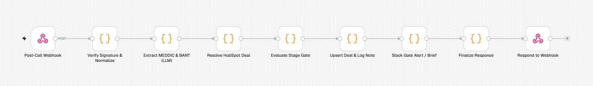

# n8n-hubspot-post-call-meddic-bant-extractor

Post-call qualification on autopilot: an **n8n workflow** and a **deterministic Node.js mirror** that take a call transcript from **Gong**, **Fireflies.ai**, or **Fathom**, extract **MEDDIC** and **BANT** qualification with an LLM under a strict JSON schema, upsert the results onto the matching **HubSpot Deal**, log a qualification note, and flag missing stage-gate criteria in **Slack** before the deal moves forward.

I built this as a reference implementation for revenue teams that want qualification data in the CRM without asking reps to type it in, and without trusting an LLM blindly: every evidence quote is checked against the transcript, unsupported fields are down-weighted, and nothing is written anywhere until you turn the safety switches off on purpose.

- Zero runtime dependencies (Node.js 20+, native `fetch`, `node:crypto`, `node:test`).
- The n8n workflow is generated from `src/`, and the test suite executes its Code nodes and compares the output with the Node.js mirror.
- `DRY_RUN=true` and `SANDBOX_MODE=true` by default, in both runtimes.

---

## Contents

1. [Safety defaults](#safety-defaults)
2. [Architecture](#architecture)
3. [Repository layout](#repository-layout)
4. [MEDDIC / BANT field mapping](#meddic--bant-field-mapping)
5. [HubSpot custom property setup](#hubspot-custom-property-setup)
6. [Stage-gate rules](#stage-gate-rules)
7. [Webhook payload specs](#webhook-payload-specs)
8. [Environment variables](#environment-variables)
9. [Quickstart (Node.js)](#quickstart-nodejs)
10. [Importing the n8n workflow](#importing-the-n8n-workflow)
11. [Going live checklist](#going-live-checklist)
12. [Testing](#testing)
13. [Design notes and limitations](#design-notes-and-limitations)

---

## Safety defaults

| Switch | Default | Effect |
| --- | --- | --- |
| `DRY_RUN` | `true` | HubSpot `PATCH`/`POST` calls and Slack messages are built, recorded, and returned in the response, but never sent. Read-only HubSpot lookups still run when a real token is configured. |
| `SANDBOX_MODE` | `true` | With `DRY_RUN=false`, HubSpot writes are allowed only when `GET /account-info/v3/details` reports a `SANDBOX` or `DEVELOPER_TEST` account, or the portal ID equals `HUBSPOT_SANDBOX_PORTAL_ID`. Slack messages go only to `SLACK_SANDBOX_WEBHOOK_URL` or `SLACK_SANDBOX_CHANNEL_ID`. |
| `LLM_PROVIDER` | `mock` | Offline keyword heuristics. No transcript leaves the machine. Refused when `DRY_RUN=false`. |
| `WEBHOOK_REQUIRE_SIGNATURE` | `true` | Unsigned or tampered requests get `401` before the body is parsed. Turning it off is refused when `DRY_RUN=false`. |
| `PII_REDACTION` | `true` | Emails, phone numbers, card numbers (Luhn-checked), US SSNs, IBANs, and API-key-like strings are replaced with tokens before the LLM call. |
| Placeholder HubSpot token | offline | A `your_..._here` token keeps the HubSpot client offline: a synthetic deal is used and live calls are refused. |

Both flags are **fail-safe**: only an explicit `false`, `0`, `no`, or `off` disables them. A typo such as `DRY_RUN=flase` keeps dry-run on. With `DRY_RUN=false`, the pipeline also refuses to run with a placeholder webhook secret, a placeholder HubSpot token, or the mock LLM, and returns `500 config_invalid` instead.

---

## Architecture



```
 ┌──────────┐  ┌──────────────┐  ┌──────────┐
 │   Gong   │  │ Fireflies.ai │  │  Fathom  │   post-call webhooks (or a relay that enriches them)
 └────┬─────┘  └──────┬───────┘  └────┬─────┘
      └───────────────┼───────────────┘
                      │  POST  x-signature: sha256=<hmac>   x-signature-timestamp: <unix>
                      ▼
 ┌──────────────────────────────────────────────────────────────────────────────┐
 │ 1. INGEST  (src/pipeline.js → ingestStage)                                   │
 │    size limit → HMAC-SHA256 verify (constant time, replay window)            │
 │    → JSON parse → normalize (src/normalizers/transcriptNormalizer.js)        │
 │    → idempotency check (source:callId) → PII redaction + truncation          │
 ├──────────────────────────────────────────────────────────────────────────────┤
 │ 2. EXTRACT (src/extractors/meddicBantExtractor.js)                           │
 │    prompt builder → OpenAI json_schema (strict) | Anthropic forced tool_use  │
 │    | offline mock → schema validation → evidence grounding against the       │
 │    transcript → confidence cap for ungrounded fields → 1 retry with errors   │
 ├──────────────────────────────────────────────────────────────────────────────┤
 │ 3. RESOLVE DEAL (src/services/hubspotClient.js)                              │
 │    deal ID hint → contact email → v4 associations → batch read               │
 │    → company domain → v4 associations → most recent open deal                │
 ├──────────────────────────────────────────────────────────────────────────────┤
 │ 4. STAGE GATE (src/validators/stageGateValidator.js)                         │
 │    rules for current stage + next stage → missing / low_confidence /         │
 │    ungrounded issues → weighted 0–100 score → alert policy                   │
 ├──────────────────────────────────────────────────────────────────────────────┤
 │ 5. WRITE  ── safety interlock (DRY_RUN → intercept, SANDBOX_MODE → verify) ──│
 │    PATCH deal properties (confidence-aware, never downgrades)                │
 │    POST note associated to the deal (assoc type 214)                         │
 ├──────────────────────────────────────────────────────────────────────────────┤
 │ 6. NOTIFY (src/services/slackNotifier.js)                                    │
 │    blocked gate alert │ deal brief on pass │ unmatched-deal alert            │
 ├──────────────────────────────────────────────────────────────────────────────┤
 │ 7. FINALIZE → mark processed → JSON response (status, gate, actions)         │
 └──────────────────────────────────────────────────────────────────────────────┘

   n8n: Webhook → [one Code node per stage, same functions] → Respond to Webhook
   Node: src/index.js HTTP server → processWebhook() → same stages, same order
```

Every stage receives and returns a plain JSON context. Once a stage sets the status to anything other than `accepted` (rejected, duplicate, failed), the later stages pass the context through untouched, so the n8n workflow is a straight line with no branching and still responds with the right HTTP status.

---

## Repository layout

```
.
├── README.md
├── LICENSE
├── DISCLAIMER.md
├── .gitignore
├── .env.example
├── package.json
├── config/
│   └── qualification-rules.example.json   # stage gates, thresholds, property map, Slack flags
├── workflows/
│   └── n8n-hubspot-post-call-meddic-bant-extractor.json   # generated, importable
├── scripts/
│   └── build-n8n-workflow.js              # regenerates the workflow from src/
├── src/
│   ├── index.js                           # HTTP server, --simulate, --validate-schema
│   ├── pipeline.js                        # config loader + the seven stages
│   ├── normalizers/transcriptNormalizer.js
│   ├── extractors/meddicBantExtractor.js
│   ├── validators/stageGateValidator.js
│   ├── services/hubspotClient.js
│   ├── services/slackNotifier.js
│   └── utils/security.js
├── fixtures/
│   ├── sample-gong-webhook.json
│   ├── sample-fireflies-webhook.json
│   └── sample-fathom-webhook.json
└── tests/
    └── extractor.test.js
```

`src/pipeline.js` and `scripts/build-n8n-workflow.js` sit alongside the files in the original specification: the first is the shared stage layer both runtimes call, the second is what keeps the n8n JSON identical to `src/`.

---

## MEDDIC / BANT field mapping

Each field is stored as a value property (multi-line text) and a confidence property (number, 0–1). Property names are configurable in `hubspotPropertyMap`.

| Field key | Framework | What the LLM looks for | HubSpot value property | HubSpot confidence property |
| --- | --- | --- | --- | --- |
| `metrics` | MEDDIC | Quantified outcomes: % reduction, hours saved, revenue/cost impact | `meddic_metrics` | `meddic_metrics_confidence` |
| `economic_buyer` | MEDDIC | Named person and title with final budget authority | `meddic_economic_buyer` | `meddic_economic_buyer_confidence` |
| `decision_criteria` | MEDDIC | Technical, commercial, compliance evaluation criteria | `meddic_decision_criteria` | `meddic_decision_criteria_confidence` |
| `decision_process` | MEDDIC | Steps, approvals, reviews between now and signature | `meddic_decision_process` | `meddic_decision_process_confidence` |
| `identify_pain` | MEDDIC | The business problem and the cost of leaving it unsolved | `meddic_identify_pain` | `meddic_identify_pain_confidence` |
| `champion` | MEDDIC | Named buyer-side person actively selling internally | `meddic_champion` | `meddic_champion_confidence` |
| `budget` | BANT | Allocated or expected amount, range, source, fiscal timing | `bant_budget` | `bant_budget_confidence` |
| `authority` | BANT | Who holds decision authority and whether they are engaged | `bant_authority` | `bant_authority_confidence` |
| `need` | BANT | The capability or outcome the buyer says they need | `bant_need` | `bant_need_confidence` |
| `timeline` | BANT | Target decision date, go-live date, or deadline event | `bant_timeline` | `bant_timeline_confidence` |

Summary properties written on every processed call:

| Property | Type | Content |
| --- | --- | --- |
| `qualification_score` | number | Weighted 0–100 score (`scoringWeights` × status × grounding × confidence) |
| `qualification_gate_status` | enumeration | `passed`, `blocked`, or `not_evaluated` |
| `qualification_missing_fields` | multi-line text | e.g. `Champion (missing); Budget (low confidence)` |
| `qualification_last_extracted_at` | datetime | ISO 8601 timestamp of the extraction |
| `qualification_source_call_id` | single-line text | `gong:<call id>`, `fireflies:<id>`, or `fathom:<recording id>` |

### Extraction schema (per field)

```json
{
  "value": "string | null",
  "status": "identified | partial | missing",
  "confidence": 0.0,
  "evidence": ["verbatim transcript quote", "..."]
}
```

Top level: `{ "fields": { <10 fields> }, "summary": "...", "next_steps": [], "risks": [] }`. Every object is closed (`additionalProperties: false`) and every property is required, which is what OpenAI strict structured outputs demand. `npm run validate:schema` checks that.

### What happens to LLM output before anything is written

1. **Schema validation.** Wrong types, unknown keys, missing fields, or bad enum values fail the attempt. The pipeline retries once with the validation errors appended, then fails closed (`502 extraction_schema_validation_failed`).
2. **Semantic checks.** Confidence must be within 0–1; `status` and `value` contradictions are coerced (a value with status `missing` is discarded); evidence is capped at 3 quotes of 300 characters.
3. **Grounding.** Every evidence quote is normalized (case, punctuation, smart quotes, ellipses) and must appear in the redacted transcript or vendor summary. Quotes that don't are dropped.
4. **Confidence cap.** A non-missing field with zero grounded quotes is capped at `0.4` and marked `grounded: false`.
5. **Write policy.** A field is written only when confidence ≥ `propertyWrite.minConfidenceToWrite`, it is grounded, and it would not overwrite a stored value that carries a higher stored confidence.

---

## HubSpot custom property setup

### 1. Private App scopes

Create a Private App (Settings → Integrations → Private Apps) in a **sandbox or developer test account first**. The runtime needs:

- `crm.objects.deals.read`, `crm.objects.deals.write`
- `crm.objects.contacts.read`
- `crm.objects.companies.read`
- `crm.schemas.deals.write` (only for the one-time property creation below; you can remove it afterwards)

Notes are created through `POST /crm/v3/objects/notes` with an association to the deal. If HubSpot rejects that call with `403`, add the scope HubSpot shows for notes/engagements in your Private App settings.

### 2. Property group and properties

Run this once against a sandbox portal. It uses only `curl`:

```bash
export HUBSPOT_PRIVATE_APP_TOKEN=your_hubspot_private_app_token_here
API=https://api.hubapi.com
GROUP=meddic_bant_qualification

hs() { curl -sS -X POST "$API$1" -H "Authorization: Bearer $HUBSPOT_PRIVATE_APP_TOKEN" -H "Content-Type: application/json" -d "$2"; echo; }

hs /crm/v3/properties/deals/groups '{"name":"'"$GROUP"'","label":"MEDDIC / BANT Qualification","displayOrder":-1}'

while IFS='|' read -r name label; do
  hs /crm/v3/properties/deals '{"name":"'"$name"'","label":"'"$label"'","type":"string","fieldType":"textarea","groupName":"'"$GROUP"'"}'
  hs /crm/v3/properties/deals '{"name":"'"$name"'_confidence","label":"'"$label"' Confidence","type":"number","fieldType":"number","groupName":"'"$GROUP"'"}'
done <<'PROPS'
meddic_metrics|MEDDIC Metrics
meddic_economic_buyer|MEDDIC Economic Buyer
meddic_decision_criteria|MEDDIC Decision Criteria
meddic_decision_process|MEDDIC Decision Process
meddic_identify_pain|MEDDIC Identify Pain
meddic_champion|MEDDIC Champion
bant_budget|BANT Budget
bant_authority|BANT Authority
bant_need|BANT Need
bant_timeline|BANT Timeline
PROPS

hs /crm/v3/properties/deals '{"name":"qualification_score","label":"Qualification Score","type":"number","fieldType":"number","groupName":"'"$GROUP"'"}'
hs /crm/v3/properties/deals '{"name":"qualification_missing_fields","label":"Qualification Missing Fields","type":"string","fieldType":"textarea","groupName":"'"$GROUP"'"}'
hs /crm/v3/properties/deals '{"name":"qualification_last_extracted_at","label":"Qualification Last Extracted At","type":"datetime","fieldType":"date","groupName":"'"$GROUP"'"}'
hs /crm/v3/properties/deals '{"name":"qualification_source_call_id","label":"Qualification Source Call ID","type":"string","fieldType":"text","groupName":"'"$GROUP"'"}'
hs /crm/v3/properties/deals '{"name":"qualification_gate_status","label":"Qualification Gate Status","type":"enumeration","fieldType":"select","groupName":"'"$GROUP"'","options":[{"label":"Passed","value":"passed","displayOrder":0},{"label":"Blocked","value":"blocked","displayOrder":1},{"label":"Not evaluated","value":"not_evaluated","displayOrder":2}]}'
```

A `409` response means the property already exists. If you prefer different internal names, change them in `hubspotPropertyMap` in your rules file.

### 3. Find your pipeline and stage IDs

```bash
curl -sS "$API/crm/v3/pipelines/deals" -H "Authorization: Bearer $HUBSPOT_PRIVATE_APP_TOKEN"
```

Copy each pipeline `id` and stage `id` into `config/qualification-rules.local.json`. The example file uses the IDs of HubSpot's default "Sales Pipeline" (`default`, `appointmentscheduled`, `qualifiedtobuy`, ...). Custom pipelines use numeric IDs. Deals in a pipeline the rules don't define fall back to `defaultPipelineId`, and the response flags `usedFallbackPipeline: true`.

### 4. Optional: enforce the gate inside HubSpot

This project flags; it does not move or lock deals. To hard-block stage changes, add a HubSpot workflow or a pipeline rule that uses `qualification_gate_status = blocked` (or required properties per stage, where your HubSpot tier supports them).

---

## Stage-gate rules

`config/qualification-rules.example.json` (copy to `config/qualification-rules.local.json`, which is git-ignored):

```jsonc
{
  "version": 1,
  "defaultPipelineId": "default",
  "defaults": { "minConfidence": 0.6, "requireGroundedEvidence": true, "alertOnUnknownStage": true },
  "fieldOverrides": { "economic_buyer": { "minConfidence": 0.7 }, "budget": { "minConfidence": 0.65 } },
  "scoringWeights": { "metrics": 12, "economic_buyer": 14, "...": 0 },
  "pipelines": {
    "default": {
      "stageOrder": ["appointmentscheduled", "qualifiedtobuy", "presentationscheduled", "decisionmakerboughtin", "contractsent", "closedwon"],
      "terminalStages": ["closedwon", "closedlost"],
      "stages": {
        "presentationscheduled": {
          "label": "Presentation Scheduled",
          "requiredToEnter": ["identify_pain", "need", "timeline", "metrics", "champion"],
          "minConfidence": 0.6,
          "blockAdvance": true,
          "slack": { "alertOnMissing": true, "mentionOwner": false, "severity": "warning" }
        }
      }
    }
  },
  "notifications": { "alertOnUnmatchedDeal": true, "alertOnAmbiguousDeal": true, "sendDealBriefOnPass": true },
  "hubspotPropertyMap": { "fields": { "...": {} }, "summary": { "...": "" } },
  "propertyWrite": { "enabled": true, "minConfidenceToWrite": 0.5, "requireGroundedEvidence": true, "allowOverwriteWithLowerConfidence": false },
  "note": { "enabled": true }
}
```

How a gate is evaluated:

- **Target stage** is the stage after the deal's current stage in `stageOrder`. The gate checks that stage's `requiredToEnter` fields.
- **Current stage** requirements are checked too. A deal already sitting in a stage without its criteria is reported as `currentStageIssues` (a regression alert).
- **Effective threshold** per field is the highest of `defaults.minConfidence`, the stage's `minConfidence`, and the field's override.
- **Issue reasons:** `missing`, `low_confidence`, or `ungrounded` (no verbatim evidence while `requireGroundedEvidence` is on).
- **Closed deals** (`terminalStages`) are not evaluated. **Unknown stages** produce a `not_evaluated` alert so you notice when a pipeline changes.

Rules are validated on startup and by `npm run validate:schema`. In n8n, the example rules are embedded in each Code node at build time; override them with `QUALIFICATION_RULES_JSON` (single-line JSON) on the n8n host.

---

## Webhook payload specs

### Signing contract (all sources)

```
POST /webhooks/post-call                 (n8n: /webhook/post-call-meddic-bant)
Content-Type: application/json
x-signature: sha256=<hex HMAC-SHA256(WEBHOOK_SIGNING_SECRET, "<timestamp>.<raw body>")>
x-signature-timestamp: <unix seconds or milliseconds>     (optional unless WEBHOOK_REQUIRE_TIMESTAMP=true)
x-transcript-source: gong | fireflies | fathom          (optional; otherwise detected from the payload shape)
```

Without a timestamp header, the signed string is the raw body alone. Header names are configurable. `sha256=<hex>`, `v1=<hex>`, bare hex, and comma-separated candidates are accepted. Timestamps outside `WEBHOOK_TOLERANCE_SECONDS` are rejected.

Gong, Fireflies.ai, and Fathom each sign (or don't sign) their own webhooks in their own way, and those schemes change. Rather than hard-coding three vendor schemes, I verify one documented contract. The usual setup is a small relay (or an n8n sub-workflow) that receives the vendor webhook, checks the vendor's own signature, fetches the transcript if the vendor only sends a notification, and forwards the enriched JSON signed with your secret. If a vendor's native scheme is a plain HMAC-SHA256 of the body in a header, you can point `WEBHOOK_SIGNATURE_HEADER` at that header and skip the relay. Check the vendor's current documentation before relying on that.

### Unified internal schema

```json
{
  "schemaVersion": 1,
  "source": "gong",
  "callId": "8800000000000000001",
  "title": "Acme Corp | Discovery and Qualification",
  "startedAt": "2026-11-12T15:02:10.000Z",
  "durationSeconds": 2280,
  "url": "https://...",
  "participants": [{ "name": "Jane Doe", "email": "jane.doe@acme.example", "role": "external" }],
  "externalDomains": ["acme.example"],
  "externalEmails": ["jane.doe@acme.example"],
  "transcript": "Alex Rivera: ...\nJane Doe: ...",
  "summary": "Vendor summary or null",
  "crm": { "dealIdHint": "1000000001" }
}
```

Participants are classified by `INTERNAL_EMAIL_DOMAINS` first, then by the vendor's own flag; any other email domain counts as external. Free-mail domains are excluded from company-domain matching. Consecutive turns by the same speaker are merged. Participant emails are used for the HubSpot lookup and then stripped from the context; they are never sent to the LLM or to Slack.

Any payload may carry an explicit deal ID at `hubspot_deal_id`, `metadata.hubspot_deal_id`, or `crm.hubspot_deal_id` (digits only). That wins over email/domain matching.

### Gong (`fixtures/sample-gong-webhook.json`)

| Unified field | Gong path |
| --- | --- |
| `callId` | `callData.metaData.id` |
| `title` | `callData.metaData.title` |
| `startedAt` | `callData.metaData.started` |
| `durationSeconds` | `callData.metaData.duration` |
| `url` | `callData.metaData.url` |
| `participants` | `callData.parties[]` → `name`, `emailAddress`, `affiliation` (`Internal`/`External`), `speakerId` |
| `transcript` | `callData.transcript[]` → `speakerId` + `sentences[].text` |
| `summary` | `callData.content.brief` |
| `crm.dealIdHint` | `callData.context[]` where `system = HubSpot` → `objects[]` where `objectType = Deal` → `objectId` |

Depending on your Gong setup, the call-level webhook may not include the transcript. In that case, fetch it from Gong's transcript API in your relay and merge it in as `callData.transcript`, in the monologue shape shown in the fixture.

### Fireflies.ai (`fixtures/sample-fireflies-webhook.json`)

| Unified field | Fireflies path |
| --- | --- |
| `callId` | `data.id` (falls back to `meetingId`) |
| `title` | `data.title` |
| `startedAt` | `data.date` (epoch ms) |
| `durationSeconds` | `data.duration` (minutes) × 60 |
| `url` | `data.transcript_url` |
| `participants` | `data.meeting_attendees[]` (`displayName`, `email`), `data.participants[]` (emails), `data.organizer_email` (internal) |
| `transcript` | `data.sentences[]` → `speaker_name`, `text` |
| `summary` | `data.summary.overview` (or `short_summary`) |

The Fireflies "Transcription completed" webhook is a notification carrying `meetingId`. The fixture represents that notification enriched with the transcript fields your relay fetched from the Fireflies GraphQL API, nested under `data`.

### Fathom (`fixtures/sample-fathom-webhook.json`)

| Unified field | Fathom path |
| --- | --- |
| `callId` | `recording_id` (falls back to `id`) |
| `title` | `meeting_title` (falls back to `title`) |
| `startedAt` | `recording_start_time` → `scheduled_start_time` → `created_at` |
| `durationSeconds` | `recording_end_time` − `recording_start_time` |
| `url` | `share_url` (falls back to `url`) |
| `participants` | `calendar_invitees[]` (`name`, `email`, `is_external`), `recorded_by` (internal) |
| `transcript` | `transcript[]` → `speaker.display_name`, `text` |
| `summary` | `default_summary.markdown_formatted` |

Vendor payloads evolve. The fixtures are synthetic and representative; compare them with a real (sandbox) payload from your account and adjust the normalizer if a path differs.

### Response

```json
{
  "status": "processed",
  "dryRun": true,
  "sandboxMode": true,
  "source": "gong",
  "callId": "8800000000000000001",
  "deal": { "id": "1000000001", "name": "...", "stage": "qualifiedtobuy" },
  "dealMatch": { "matchedBy": "deal_id", "candidates": 1, "ambiguous": false },
  "gate": { "evaluated": true, "passed": false, "blockAdvance": true, "targetStageId": "presentationscheduled",
            "issues": [{ "field": "champion", "reason": "missing" }], "currentStageIssues": [] },
  "score": 62,
  "fields": { "metrics": { "status": "identified", "confidence": 0.7 } },
  "privacy": { "redactions": { "email": 1, "phone": 1 }, "truncated": false },
  "actions": {
    "hubspot": { "propertyUpdate": { "mode": "intercepted_dry_run", "written": ["metrics"] }, "note": { "mode": "intercepted_dry_run" } },
    "slack": { "mode": "intercepted_dry_run", "kind": "gate_alert" }
  },
  "warnings": []
}
```

| HTTP | Meaning |
| --- | --- |
| `200` | `processed`, or `duplicate` (same `source:callId` already processed) |
| `400` | Body is not JSON |
| `401` | `webhook_missing_signature`, `webhook_signature_mismatch`, `webhook_timestamp_outside_tolerance`, ... |
| `413` | Body larger than `WEBHOOK_MAX_BODY_BYTES` |
| `422` | Payload shape not recognised, no transcript/summary, or no call ID |
| `500` | `config_invalid` (live mode with placeholders or the mock LLM) |
| `502` | LLM or HubSpot API failure, or LLM output still invalid after the retry |
| `503` | A safety interlock refused a live write (for example, `SANDBOX_MODE=true` against a production portal) |

Slack failures don't fail the request (the CRM write already happened); they appear in `warnings` and `actions.slack.mode = "error"`.

---

## Environment variables

| Variable | Default | Purpose |
| --- | --- | --- |
| `DRY_RUN` | `true` | Intercept every HubSpot and Slack mutation |
| `SANDBOX_MODE` | `true` | Restrict live writes to sandbox HubSpot portals and sandbox Slack targets |
| `PORT` | `3000` | Node.js server port |
| `WEBHOOK_PATH` | `/webhooks/post-call` | Node.js webhook route |
| `LOG_LEVEL` | `info` | `debug`, `info`, `warn`, `error` (transcripts are never logged) |
| `WEBHOOK_SIGNING_SECRET` | — | HMAC-SHA256 secret (required when `DRY_RUN=false`) |
| `WEBHOOK_SIGNATURE_HEADER` | `x-signature` | Header carrying the signature |
| `WEBHOOK_TIMESTAMP_HEADER` | `x-signature-timestamp` | Header carrying the timestamp |
| `WEBHOOK_REQUIRE_SIGNATURE` | `true` | `false` is allowed only in dry run |
| `WEBHOOK_REQUIRE_TIMESTAMP` | `false` | Require the replay-protection timestamp |
| `WEBHOOK_TOLERANCE_SECONDS` | `300` | Allowed clock skew |
| `WEBHOOK_MAX_BODY_BYTES` | `2000000` | Request size limit |
| `INTERNAL_EMAIL_DOMAINS` | `example.com` | Comma-separated seller domains |
| `LLM_PROVIDER` | `mock` | `mock`, `openai`, or `anthropic` |
| `LLM_MODEL` | — | Model ID (required for `openai`/`anthropic`) |
| `OPENAI_API_KEY` / `OPENAI_BASE_URL` | — / `https://api.openai.com/v1` | OpenAI or a compatible endpoint that supports `response_format: json_schema` |
| `ANTHROPIC_API_KEY` / `ANTHROPIC_BASE_URL` | — / `https://api.anthropic.com` | Anthropic Messages API (forced tool use) |
| `LLM_TIMEOUT_MS` | `60000` | Per-call timeout |
| `LLM_MAX_ATTEMPTS` | `2` | Initial call plus retries with validation feedback |
| `PII_REDACTION` | `true` | Redact PII before the LLM call |
| `MAX_TRANSCRIPT_CHARS` | `60000` | Truncation budget (keeps 70% head, 30% tail) |
| `HUBSPOT_PRIVATE_APP_TOKEN` | — | Private App token; a placeholder keeps the client offline |
| `HUBSPOT_PORTAL_ID` | — | Used only to build deal links in Slack |
| `HUBSPOT_SANDBOX_PORTAL_ID` | — | Pin live sandbox writes to exactly this portal |
| `HUBSPOT_BASE_URL` / `HUBSPOT_APP_BASE_URL` | `https://api.hubapi.com` / `https://app.hubspot.com` | API and UI hosts |
| `SIMULATE_DEAL_STAGE_ID` | `qualifiedtobuy` | Stage of the synthetic deal used while offline |
| `SLACK_WEBHOOK_URL` | — | Production incoming webhook (must start with `https://hooks.slack.com/`) |
| `SLACK_BOT_TOKEN` / `SLACK_CHANNEL_ID` | — | Alternative: `chat.postMessage` (scope `chat:write`) |
| `SLACK_SANDBOX_WEBHOOK_URL` / `SLACK_SANDBOX_CHANNEL_ID` | — | Required targets while `SANDBOX_MODE=true` |
| `OWNER_SLACK_MAP_JSON` | `{}` | `{"<hubspot owner id>":"<slack user id>"}` for owner mentions |
| `QUALIFICATION_RULES_PATH` | — | Path to a rules file (relative to the repo root) |
| `QUALIFICATION_RULES_JSON` | — | Inline rules JSON (takes precedence; this is how n8n overrides the embedded rules) |

---

## Quickstart (Node.js)

```bash
git clone https://github.com/dhrobinsystems/n8n-hubspot-post-call-meddic-bant-extractor.git
cd n8n-hubspot-post-call-meddic-bant-extractor

npm test                   # 52 tests, no network
npm run validate:schema    # schema, rules, workflow structure and parity
npm run simulate           # all three fixtures end to end, DRY_RUN forced on
```

`npm run simulate` prints, per fixture, the matched deal, score, gate verdict, intercepted HubSpot writes, the Slack message kind, and PII redaction counts. `npm run simulate -- --json` prints the full responses, including the property payload that would have been sent. With the shipped fixtures and the mock extractor, Gong is blocked for a missing Champion, Fireflies passes and produces a deal brief, and Fathom is blocked for missing Metrics.

Run the server and send a signed request:

```bash
cp .env.example .env
# set WEBHOOK_SIGNING_SECRET in .env to a random value, e.g. from: openssl rand -hex 32
npm start

SECRET=the_value_you_set
FILE=fixtures/sample-fathom-webhook.json
TS=$(date +%s)
SIG=$( { printf '%s.' "$TS"; cat "$FILE"; } | openssl dgst -sha256 -hmac "$SECRET" | awk '{print $NF}')

curl -sS -X POST http://localhost:3000/webhooks/post-call \
  -H "Content-Type: application/json" \
  -H "x-signature: sha256=$SIG" \
  -H "x-signature-timestamp: $TS" \
  --data-binary @"$FILE"
```

Sign the exact bytes you send: `--data-binary @file` keeps the trailing newline, `$(cat file)` would drop it.

To try a real model in dry run, set `LLM_PROVIDER=openai` (or `anthropic`), `LLM_MODEL`, and the matching API key. The fixtures contain only fictional data, so this is a safe first test of the prompt.

---

## Importing the n8n workflow

1. In n8n: **Workflows → Import from File** → `workflows/n8n-hubspot-post-call-meddic-bant-extractor.json`.
2. On the n8n host, set:
   - `NODE_FUNCTION_ALLOW_BUILTIN=crypto` (HMAC verification in the Code node),
   - `N8N_BLOCK_ENV_ACCESS_IN_NODE=false` (every setting is read from `$env`),
   - the same variables as `.env.example`, starting with `DRY_RUN=true` and `SANDBOX_MODE=true`.
3. Restart n8n so the environment is picked up, open the workflow, and run a test request against the **test URL** (`/webhook-test/post-call-meddic-bant`) with the curl command above.
4. Activate the workflow only after the dry-run responses look right.

What's inside:

| Node | Type | Runs |
| --- | --- | --- |
| Post-Call Webhook | Webhook v2, `rawBody: true`, respond via node | — |
| Verify Signature & Normalize | Code | `ingestStage` |
| Extract MEDDIC & BANT (LLM) | Code | `extractStage` |
| Resolve HubSpot Deal | Code | `resolveDealStage` |
| Evaluate Stage Gate | Code | `gateStage` |
| Upsert Deal & Log Note | Code | `writeStage` |
| Slack Gate Alert / Brief | Code | `notifyStage` |
| Finalize Response | Code | `finalizeStage` |
| Respond to Webhook | Respond to Webhook (status `{{$json.httpStatus}}`) | — |

Notes on the n8n build:

- **Generated, not hand-edited.** Each Code node contains the `src/` modules (imports and `export` keywords removed) plus a few lines that call one stage. Change `src/`, then run `npm run build:workflow`. The test suite fails if the committed JSON differs from a fresh build, and it executes the Code nodes in-process to confirm they produce the same response as the Node.js mirror.
- **HTTP calls** use `this.helpers.httpRequest` with `returnFullResponse` and `ignoreHttpStatusErrors`, wrapped in a small `fetch`-shaped adapter. The raw body comes from the Webhook node's binary property via `this.helpers.getBinaryDataBuffer`. Both are standard Code-node helpers on current n8n 1.x releases; if your version or task-runner setup doesn't expose them, the Node.js mirror is the supported path.
- **Credentials** are never stored in the workflow; there are no n8n credential references. Everything comes from `$env`.
- **Idempotency** uses workflow static data (`processedCalls`, 7-day TTL). n8n persists static data only for production (active-workflow) executions, so manual test runs don't deduplicate.
- **Privacy.** The workflow setting `saveDataSuccessExecution: none` keeps successful executions (which carry call content) out of the execution log. Failed executions are saved for debugging; prune them on a schedule.
- **Size.** Each Code node embeds the full library, so the JSON is about 700 KB. That's the cost of byte-for-byte parity without a shared module system in n8n.

---

## Going live checklist

1. **Sandbox, dry run.** `DRY_RUN=true`, `SANDBOX_MODE=true`, real LLM provider, sandbox HubSpot token. Send real (consented) calls. Review the `properties` payload in the response and the deals that were matched.
2. **Sandbox, live.** `DRY_RUN=false`, `SANDBOX_MODE=true`, `HUBSPOT_SANDBOX_PORTAL_ID` set, `SLACK_SANDBOX_WEBHOOK_URL` set. Confirm properties, notes, and Slack alerts look right in the sandbox portal and channel.
3. **Rules.** Replace the example stage IDs with your pipeline's IDs in `config/qualification-rules.local.json` (or `QUALIFICATION_RULES_JSON` for n8n) and run `npm run validate:schema`.
4. **Production.** Create a production Private App with the minimum scopes, rotate `WEBHOOK_SIGNING_SECRET`, set `WEBHOOK_REQUIRE_TIMESTAMP=true`, then set `SANDBOX_MODE=false`.
5. **Monitor.** Watch `warnings` in responses (dropped quotes, capped confidence) for the first weeks. Many warnings usually mean the prompt or model needs tuning for your call style.

---

## Testing

```bash
npm test
```

`tests/extractor.test.js` covers:

- **Security:** valid, tampered, wrong-secret, stale-timestamp, malformed, and missing signatures; PII redaction (and what must not be redacted, like money and dates); truncation and control-character stripping.
- **Normalization:** source detection, all three vendor shapes, participant classification, deal-ID hints, free-mail handling, and error codes.
- **Schema validation:** strict-mode compatibility, unknown keys, wrong types and enums, confidence range, hallucinated-quote removal, confidence capping, ellipsis/quote-tolerant grounding, fenced JSON parsing, and transcript-tag injection guarding.
- **LLM clients:** OpenAI `json_schema` strict request shape, Anthropic forced `tool_use`, retry-with-feedback, fail-closed behaviour, and error messages that don't echo response bodies.
- **Stage gates:** rules validation, missing / low-confidence / ungrounded detection, field overrides, current-stage regressions, closed, unknown, and fallback pipelines.
- **HubSpot:** confidence-aware write planning, deal selection, email → association → batch-read lookup, `429` retry with `Retry-After`.
- **Dry-run and sandbox gates:** fail-safe flag parsing, live-mode config refusal, zero mutation calls in dry run, sandbox account-type and portal pinning, offline token behaviour, Slack sandbox routing, and refusal of non-Slack webhook hosts.
- **End to end:** every fixture through `processWebhook` with a recording `fetch` that asserts no network or mutation calls, plus duplicate and bad-signature paths.
- **n8n parity:** workflow structure, credential scan, rebuild equality, and execution of the actual Code nodes against all three fixtures compared with the Node.js mirror.

---

## Design notes and limitations

- **Why an evidence check?** LLMs are good at summarising sales calls and also good at producing plausible MEDDIC fields that nobody said. Requiring verbatim quotes and verifying them deterministically turns "trust the model" into "trust the model only where the transcript backs it up."
- **Mock mode is not extraction.** `LLM_PROVIDER=mock` exists so the full pipeline, safety gates, and tests run with zero external calls. Its keyword rules are deliberately simple and are refused for live writes.
- **Redaction is pattern-based.** It catches common identifiers, not names, addresses, or free-text secrets. Participant names are passed to the LLM as speaker labels because MEDDIC needs them (Economic Buyer, Champion).
- **Deal matching is heuristic.** When several open deals match, the most recently modified one wins and the Slack message says so. Passing an explicit deal ID from your call recorder's CRM integration is the most reliable option.
- **Flags, not locks.** The project reports gate status; enforcement (blocking a stage change) is up to your HubSpot workflows or required-property settings.
- **Single-process idempotency** in the Node.js mirror is in memory. For multiple instances, put a shared store (Redis, a database) behind the same `has`/`add` interface as `createSeenStore`.

---

## ⚠️ Disclaimer & Liability Limitation

**Use at your own risk.** The code, workflows, and scripts provided in this repository (`n8n-hubspot-post-call-meddic-bant-extractor`) are for educational and architectural demonstration purposes.

* **No Liability:** The author and dhRobin Systems assume no responsibility or liability for any direct, indirect, incidental, or consequential damages resulting from the use, misuse, or deployment of these scripts.
* **No Warranty:** All software, n8n JSON blueprints, and JavaScript modules are provided "AS IS" without warranty of any kind, express or implied, including but not limited to merchantability, fitness for a particular purpose, or non-infringement.
* **Production Testing Required:** Always test thoroughly in an isolated staging environment (for example a HubSpot developer test account or sandbox) with `SANDBOX_MODE=true` and `DRY_RUN=true` enabled before connecting live HubSpot credentials. Treat every deal property overwrite and every logged note as permanent CRM history.
* **AI-Generated Output:** MEDDIC and BANT values, confidence scores, and stage-gate verdicts are produced by a language model and can be wrong. They are decision support for the deal owner, not a replacement for their judgement.
* **Third-Party APIs & Compliance:** Users are solely responsible for complying with the terms of service, rate limits, data privacy regulations (GDPR/CCPA), and security policies of HubSpot, Gong, Fireflies.ai, Fathom, OpenAI, Anthropic, Slack, and any other connected service. That includes confirming call-recording consent for every participant, a lawful basis for sending transcripts to an LLM provider, and reviewing every automated property overwrite and Slack alert.

The full disclaimer is also available in [DISCLAIMER.md](https://github.com/dhrobinsystems/n8n-hubspot-post-call-meddic-bant-extractor/blob/main/DISCLAIMER.md).

## License

Released under the MIT License. Copyright (c) 2026 DH Robin (dhRobin Systems). See [LICENSE](https://github.com/dhrobinsystems/n8n-hubspot-post-call-meddic-bant-extractor/blob/main/LICENSE).
